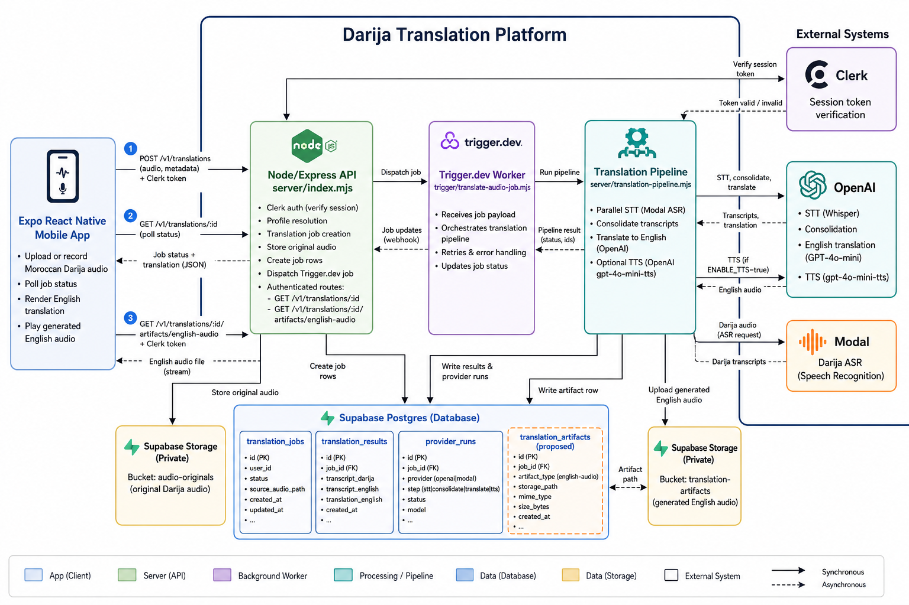
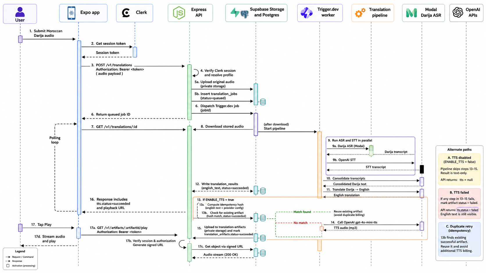
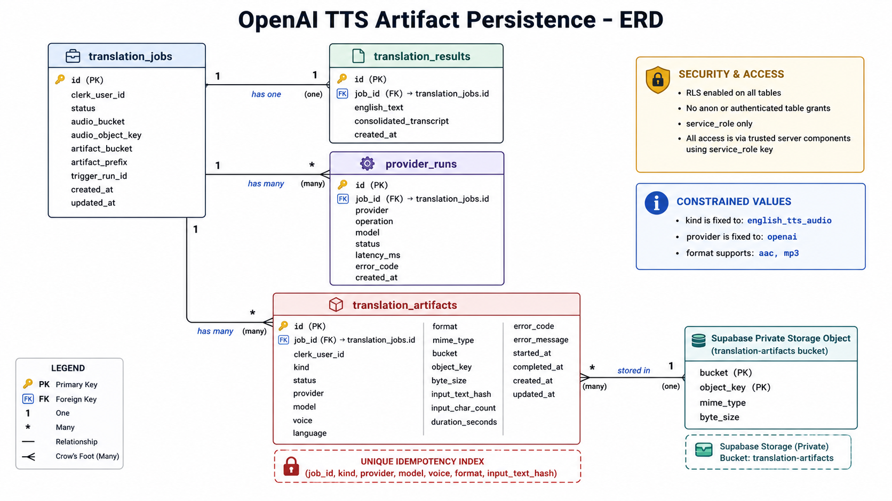
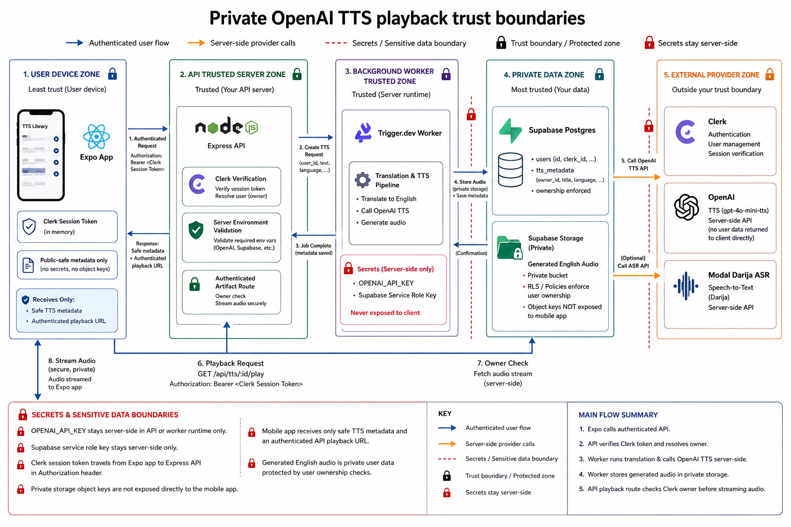
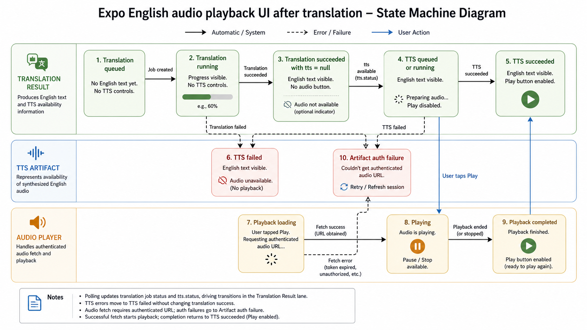

# OpenAI TTS Visual Architecture

This folder stores the visual prompt plan for the OpenAI TTS English playback PRD. The generated diagrams are created with Codex ImageGen from the prompts in `imagegen-prompts.md`.

## Source Anchors

- `ai_docs/prd/openai-tts-english-playback/05-architecture-plan.md`
- `ai_docs/prd/openai-tts-english-playback/06-technical-specifications.md`
- `server/index.mjs`
- `server/translation-pipeline.mjs`
- `server/storage.mjs`
- `server/translations.mjs`
- `trigger/translate-audio-job.mjs`
- `lib/api.ts`
- `lib/types.ts`
- `app/translate.tsx`
- `app/history.tsx`

## Diagram Set

| # | Diagram | Purpose |
| --- | --- | --- |
| 1 | [C4 container architecture](images/01-c4-container-architecture.png) | Show the major app, API, worker, database/storage, and provider boundaries for TTS playback. |
| 2 | [End-to-end runtime sequence](images/02-runtime-sequence.png) | Show the exact call order from mobile upload through translation, TTS generation, artifact upload, polling, and playback. |
| 3 | [TTS artifact persistence model](images/03-artifact-persistence-model.png) | Show the proposed `translation_artifacts` table and its relationship to existing translation records and private storage. |
| 4 | [Trust boundary and access-control flow](images/04-trust-boundary-access-control.png) | Show which components can see tokens, API keys, storage object keys, text, and generated audio. |
| 5 | [Mobile playback state flow](images/05-mobile-playback-state-flow.png) | Show how the app should render queued, running, succeeded, failed, and disabled TTS states without blocking text translation. |

## Generated Images

## Assumptions

- Generated audio is private user data and must remain behind authenticated API access.
- OpenAI TTS runs server-side only, after English translation has succeeded.
- TTS failure should not change the translation job from `succeeded` to `failed`.
- The first provider is OpenAI `gpt-4o-mini-tts` with voice `marin` and format `aac`, with `mp3` as fallback.
- Codex ImageGen outputs are attached in the thread; this folder keeps the durable prompt source for regeneration and design review.
